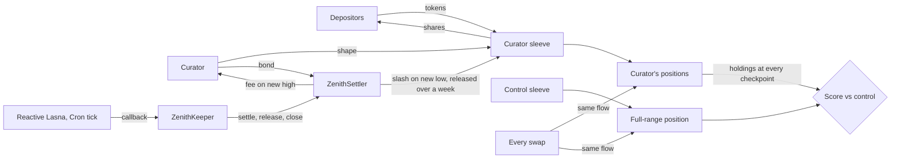

# Zenith

**Curators are paid for beating a passive twin in the same pool, and pay depositors when they fall behind it.**

Zenith is a Uniswap v4 hook for curated liquidity. Depositors fund sleeves in a shared pool. A curator posts a bond and a liquidity shape, and the hook runs that shape with the sleeve's capital. The curator never holds the money. Next to every curator sits a passive control sleeve: full-range liquidity that nobody touches, facing the same swaps in the same pool. Each period, the hook measures how much better or worse the curator did than the control would have done with the same liquidity. At a new high, the curator earns 20% of that excess; at a new low, 20% of the shortfall is taken from its bond and paid to its depositors.

Depositors get a curator whose pay depends on market-making skill, measured against a benchmark nobody can move, and whose mistakes are partly paid for by its own bond. Curators get capital without raising a fund, and a track record that can only come from skill. The settlement runs itself: Reactive Network calls it on a schedule, with no keeper bot.

Measured on mainnet, six managed Uniswap v3 vaults showed no significant skill over a passive LP, and at least four of them still took a cut of every fee. Zenith pays only for the part that is skill.

| | |
| --- | --- |
| Theme | UHI-11, Active Management and Curated Liquidity |
| Network | Unichain Sepolia, hook [`0x8EFc0b2F3E00722a9b8e653367252c720f446080`](https://sepolia.uniscan.xyz/address/0x8EFc0b2F3E00722a9b8e653367252c720f446080), verified on Sourcify |
| Partner | Reactive Network, live on Reactive Lasna: Cron callbacks reach the keeper on chain ([first one](https://sepolia.uniscan.xyz/tx/0x2637218a8d85105c0a4e486d37382e19fec6d99f2110b1a47a7f591e584e3a4f)) |
| Contracts | Hook, settler, maths library, keeper and reactive contract, every one under the 24 KB limit |
| Tests | 91 tests, including 6 invariants, 6 attack scenarios, twin-position fee tests and gas measurements; 14 planted bugs, all caught |
| Evidence | A study of 57 mainnet vaults, and an attack on six scoring rules with mainnet data that chose Zenith's ([`evidence/`](evidence/)) |
| Frontend | Not built yet. Everything below can be checked on chain or with `forge test` |

---

## Why

We found every contract that minted directly on three mainnet ETH/stablecoin pools and answers a vault interface: 57 vaults from May 2021 to July 2024. Six held at least $50,000 for at least 13 managed weeks. Each is compared with a fresh full-range position in the same pool over the same interval ([`evidence/`](evidence/)).

| Vault | Pool | Weeks | Skill vs passive, weekly (pp a year, 95% interval) | Total return | Passive | Fee cut proven on chain |
| --- | --- | --: | --: | --: | --: | --- |
| Gelato USDC/WETH `0xa6c4` | 0.05% | 19 | -9.3 (-26.7 to +8.2) | -54.5% | -37.2% | yes |
| Alpha Vault `0x9bf7` | 0.3% | 107 | -15.2 (-30.4 to +0.0) | -13.5% | +0.8% | yes |
| Visor USDC-ETH `0x716b` | 0.3% | 57 | +12.0 (-33.3 to +57.4) | -9.1% | -5.5% | not proven |
| xUSDC-ETH05 `0xa978` | 0.05% | 55 | -11.8 (-32.0 to +8.5) | -45.3% | -15.9% | not proven |
| Range WETH/USDC `0x9ad8` | 0.05% | 44 | -8.0 (-18.1 to +2.1) | +38.9% | +37.7% | yes |
| Gelato USDC/WETH `0x2441` | 0.3% | 17 | -30.6 (-71.0 to +9.7) | -18.9% | -11.9% | yes |

Three findings shaped Zenith:

1. **No vault showed significant skill.** One was nominally ahead of passive with weekly sampling, none with daily sampling.
2. **Operators were paid anyway.** In at least four of the six, the operator or protocol took a cut of every fee collected, readable from on-chain balances. The cut does not depend on beating anything.
3. **Total return mostly measures the market.** Skill explains 14% of the week-to-week variation in a vault's total-return gap to passive, and 3% of the day-to-day variation. The rest is which tokens the vault happened to hold.

"No significant skill" is not proof of no skill. The samples are short and the intervals wide. That is the point: today, nobody can tell, so nobody should be paid as if they could.

### Can skill be measured well enough to pay on?

Measured from outside, as in the study, not reliably. Our own data shows it. Skill kept its sign into the next quarter in only 8 of 15 vault-quarters, and shifting the weekly grid by a few days changes how many vaults look skilled from 1 to 3.

The study also shows why. Token-mix changes inside a sampling interval, from deposits or rebalances, leak price exposure into the measured skill. Zenith removes each cause:

- **The benchmark is a twin, not a study.** The control sleeve sits in the same pool and faces the same swaps at the same moments. Nothing about the market is estimated.
- **There is no sampling grid.** The score is taken from actual holdings at every deposit, withdrawal, reshape and settlement, so a change in token mix is never counted as skill.
- **Concentration alone scores zero.** The comparison is per unit of liquidity, so a curator who posts one narrow range and never moves it is neither rewarded in a choppy market nor punished in a trend ([`test/ZenithBenchmark.t.sol`](test/ZenithBenchmark.t.sol), [`test/ZenithScoring.t.sol`](test/ZenithScoring.t.sol)).

The rule was chosen by attacking six candidates with strategies that use only past information, on 2,653 pool-days of mainnet data ([`evidence/SCORING.md`](evidence/SCORING.md)):

| Strategy | Zenith's rule (score, t) | Per-capital comparison (score, t) |
| --- | --: | --: |
| Static range, 5x concentrated | 0.000 (t 0.0) | -1.003 (t -2.2) |
| Idle | 0.000 (t 0.0) | +0.251 (t +2.2) |
| Momentum | +0.092 (t +1.2) | +0.068 (t +0.8) |
| Double down after a bad day | -0.016 (t -0.2) | -0.085 (t -1.1) |
| Ramp liquidity up within a period | -0.042 (t -0.4) | -0.081 (t -1.3) |
| Volatility timing | -0.031 (t -0.5) | -0.333 (t -3.6) |
| **60% foresight (real skill)** | **+0.745 (t +4.7)** | +0.383 (t +3.8) |

No history-only strategy scored above |t| = 1.2, and the one strategy with real information stood out. Skill still takes many periods to show, and a single week can be lucky. So settlement is symmetric: a curator is paid on new highs of cumulative excess and slashed on new lows, so pure luck pays a curator nothing on average, and the bond, not the depositor, pays for a bad run.

---

## How it works



**Depositors** call `fund` on a sleeve and receive shares in it. The first deposit sets the sleeve's ratio; every later deposit buys the same fraction of everything the sleeve holds, idle tokens and every position alike, by adding that fraction of liquidity to each range. `withdraw` returns the same fraction of each. Depositors can leave at any time.

**Curators** open a sleeve, post a bond in token1 of at least 5% of its value, and call `setShape` with up to four ranges. The hook removes the old positions and places the new ones inside one PoolManager unlock, each sleeve under its own position salt, so fees are attributed per sleeve to the wei. A curator can reshape as often as it likes. It can never withdraw depositors' money, and an invariant test checks that no tokens or claims ever reach a curator.

**The control** is sleeve 0: full-range liquidity funded like any other and placed by `deployControl`, which nobody manages.

**The score.** Per unit of in-range liquidity, every position in the pool earns the same result over the same interval. A curator's only lever is how much liquidity it has in range, and when. So the hook keeps an index of the control's result per unit of liquidity, and scores each curator on

**excess = Σ (in-range liquidity − liquidity at period start) × (control's result per unit of liquidity − its long-run average)**

computed from actual holdings at every checkpoint. Putting liquidity in before a profitable stretch scores; putting it in before a loss costs.

**Settlement.** Every 7 days, [`ZenithSettler`](src/ZenithSettler.sol) closes the sleeve's period and adds its excess to a running total. If the total reaches a new high, the curator is paid 20% of the gain from the sleeve's token1. If it reaches a new low, 20% of the drop is taken from the bond and released to the sleeve's depositors evenly over the next week. Gaining and giving back the same amount is neither paid twice nor slashed. A sleeve whose bond falls below 5% of its value can be closed by anyone: its liquidity is removed, and only the curator, re-bonded, can deploy it again.

**Automation.** [`ZenithReactive`](src/ZenithReactive.sol) on Reactive Lasna subscribes to a Cron tick and to the hook's `SleeveFunded` event on Unichain Sepolia. On each tick it asks Reactive to call [`ZenithKeeper`](src/ZenithKeeper.sol), which settles every sleeve whose period is over, releases vested slashes and closes any sleeve whose bond falls short. On a deposit it asks the keeper to check that sleeve's bond at once, since a bigger sleeve needs a bigger bond. Everything the keeper does is also a public function, so Zenith keeps working if Reactive stops.

---

## The hard parts

### A benchmark that concentration cannot game

A concentrated range holds several times the liquidity per dollar, so it multiplies fees and losses alike. Compared with full-range capital per dollar, a curator who parks one narrow range looks brilliant in a choppy market and negligent in a trend, without doing anything. [`test/ZenithBenchmark.t.sol`](test/ZenithBenchmark.t.sol) shows this on a real PoolManager. Zenith compares per unit of liquidity instead, against the control's long-run average, and the scoring tests pin the result: a static narrow range and a copy of the control score zero, within 1e9 wei, while the static range's raw result is more than 0.1 tokens either way, and an idle sleeve never starts a period at all.

Liquidity added during a period earns the control's long-run average for free, so the score subtracts that drift. Liquidity is scored against where the period started, not where it is now: scoring against current liquidity is one of the bugs the mutation check plants, and the tests catch it.

### Prices that can be pushed within a block

Scores and bonds are valued at the pool's own price, which anyone can move for a moment. Before the first swap of each block, `beforeSwap` records the pool's price, and every checkpoint, rebase and bond check uses that block-open price. The hook returns no delta and no fee override, so a trader pays exactly what they would in a plain 0.30% pool, and the pool stays routable.

In [`test/ZenithAttacks.t.sol`](test/ZenithAttacks.t.sol), a curator that has cut its liquidity pushes the price with a 300-token swap just before settlement, then pushes it back.

| Settlement | Excess |
| --- | --: |
| No push | -0.000000000000000004 |
| Pushed inside the block | -0.79 |
| The same push held into the next block | **+37.10** |

Inside the block, the push earns nothing; the lower score is the fees the push itself paid. The last row is what the clamp prevents: to get it, a push must survive a whole block open to arbitrage. Bonds use the same price, so a push can neither force-close a bonded sleeve nor let an under-bonded curator shape.

### Two attacks our own tests found

We attacked Zenith's rules before deploying them, and two attacks worked:

- **Deposit sandwich.** Deposits used to land as idle tokens while buying shares of everything, positions included. Depositing ten times the sleeve just before a large swap and withdrawing just after took **91%** of the fees the existing depositor's positions earned. Deposits now add their share of liquidity to every range. The same attack now leaves the existing depositor exactly where it would be if the attacker had added that liquidity to the pool directly (200.0268 against 200.0268, 2 wei apart). A fuzz test over random shapes, prices and offers found and fixed a 3-wei overcharge on very large deposits along the way.
- **Slash sandwich.** Settlement runs on a known schedule. Depositing heavily just before a slashing settlement and leaving just after would have taken about 90% of the compensation. Slashes are now released over the next week, as Yearn v3 vaults unlock profits, and an attacker who stays an hour takes **0.5%**.

| Attack | Result |
| --- | --- |
| Push the price around settlement | Earns no fee inside the block |
| Push the price to force-close a bonded sleeve | Fails inside the block |
| Push the price to shape with too small a bond | Fails inside the block |
| Wash-trade through one's own range | Raises the score by 3.38 and pays a fee of 0.68, but the curator ends 5.29 tokens poorer |
| Deposit sandwich around a large swap | Exactly as good as adding the liquidity directly |
| Slash sandwich around a settlement | Takes 0.5% of the slash |

Every number is from the test of the same name. The full threat model, including what is argued but not tested, is in [`docs/threat-model.md`](docs/threat-model.md).

### Fitting under 24 KB

The hook holds every sleeve's positions, so its flows run in its own context. At 25.1 KB it was over the limit. Valuation and deposit maths moved into a linked library, `ZenithMath`, and bonds and settlement into a separate contract, `ZenithSettler`, which the hook trusts for one entry point. The settler is also what the automation calls.

| Contract | Runtime size | Compiler |
| --- | --: | --- |
| `ZenithHook` | 24,314 B | 0.8.26 |
| `ZenithSettler` | 9,023 B | 0.8.26 |
| `ZenithKeeper` | 4,630 B | 0.8.30 |
| `ZenithMath` | 2,785 B | 0.8.26 |
| `ZenithReactive` | 2,451 B | 0.8.30 |

The hook has 262 bytes to spare, which is why new features go into the settler and keeper.

### Automation that has to run on someone else's network

Our first Reactive contract was built on Reactive's legacy library. It deployed and verified, but Lasna never counted its subscriptions and it never reacted: Reactive had moved to Reactive Omni, with a new system contract, `react` called directly, and callbacks requested from the system contract. We rebuilt the keeper and reactive contract on [`reactive-lib-omni`](https://github.com/Reactive-Network/reactive-lib-omni), which needs Solidity 0.8.29 or later, while the deployed hook stays on 0.8.26. The two meet through ABI-identical interfaces ([`src/interfaces/IZenith.sol`](src/interfaces/IZenith.sol)), and the tests deploy the new contracts from their compiled artifacts.

The keeper accepts a callback only from Reactive's callback proxy, and only when the proxy reports that our own reactive contract asked for it. One failing sleeve never blocks the others, and a sweep that runs low on gas stops before a sleeve it might not finish and resumes there on the next tick. The worst case for one sleeve (four ranges, settled, slashed and force-closed in one visit) costs about 794,000 gas in a fresh transaction, inside the keeper's allowance of 1,000,000 per sleeve.

---

## Gas

Measured by [`test/ZenithGas.t.sol`](test/ZenithGas.t.sol) with Foundry 1.10.1, the version CI pins, through the test router. Every contract the call touches is cooled first, as in a fresh transaction, and the figures exclude the 21,000 base cost. The hookless pool has the same tokens, fee and liquidity, and every case starts from the same state.

| Swap | Gas | Over a hookless pool |
| --- | --: | --: |
| Hookless pool, first swap | 124,961 | |
| Zenith, first swap of the block | 137,059 | +12,098 |
| Hookless pool, later swap | 124,928 | |
| Zenith, any later swap in the block | 131,931 | +7,003 |

The first swap of each block writes one slot, the block's opening price; every later swap only reads it. Swaps never touch sleeves, scores or bonds; that work happens when curators, depositors and the keeper act.

| Operation | Gas |
| --- | --: |
| `fund`, one-range sleeve | 512,600 |
| `withdraw` a tenth, one-range sleeve | 297,462 |
| `setShape`, one range to four | 778,971 |
| `poke`, one range | 171,274 |
| `poke`, four ranges | 277,916 |
| `settle`, four ranges | 581,787 |

Every operation checkpoints the control as well as the sleeve, which is most of its cost.

---

## Security and testing

```bash
forge test                                        # 91 tests; Foundry 1.10 reports the 6 invariants as one campaign
forge test --match-contract ZenithGasTest -vv     # the gas tables above
forge test --match-contract ZenithAttacksTest -vv # the attack numbers above
script/mutation.sh                                # plants 14 bugs, expects every one caught
```

- **Invariants** ([`test/invariant/`](test/invariant/)): a handler drives random funding, withdrawals, reshapes, swaps, pokes and control redeploys, 64 calls deep in CI and 128 in the deep profile. After every call:
  1. the per-sleeve ledger equals the ERC-6909 claims the hook holds
  2. every stored range exists in the PoolManager with exactly that liquidity
  3. the hook never holds loose tokens
  4. **curators never hold funds**
  5. every share is owned
  6. a sleeve's collected fees never decrease
- **Twin positions:** every sleeve and the control earn exactly what a standalone v4 position with the same range and liquidity earns, to the wei, fuzzed over random swaps ([`test/ZenithTwinFees.t.sol`](test/ZenithTwinFees.t.sol)).
- **Attacks:** the six above, plus the scoring tests for every no-skill strategy.
- **Mutation check:** [`script/mutation.sh`](script/mutation.sh) plants 14 bugs one at a time, such as a shared position salt, a one-wei fee skim, scoring against current liquidity, spot-price valuation, idle-only deposits, a high-water mark that never advances, a slash kept by the settler, and a reactive contract that trusts a lookalike Cron event. The tests catch all 14.
- **Coverage:** 97.3% of lines, 96.4% of statements, 97.1% of functions and 79.7% of branches across `src/` (`forge coverage --ir-minimum --report summary --no-match-coverage "(^test|^script|^lib/)"`).
- **No admin.** The hook has no owner, no upgrade path and no pause, and every parameter is a constant. The initializer can bind one pool and set the settler once; the reactive contract's deployer can name its keeper once.

Identity never comes from a hook callback's `sender`, which is the router. Deposits, shapes and bonds go through Zenith's own entry points and use `msg.sender`.

---

## Hook permissions

| Callback | Why |
| --- | --- |
| `beforeInitialize` | Binds the hook to the first pool its initializer creates, rejects any other pool, and rejects native ETH. |
| `beforeSwap` | Records the pool's price before the block's first swap, so valuations use the block-open price. Returns no delta and no fee override. |

No callback changes a swap. The pool has a static 0.30% fee and routes like any other.

## Parameters

| Parameter | Value | Why |
| --- | --- | --- |
| Sleeves | 8, including the control | Bounds the keeper's sweep and the gas of a settlement round |
| Ranges per sleeve | 4 | Bounds the gas of a reshape, a checkpoint and a forced close |
| Period | 7 days | Long enough for skill to show over noise, short enough to settle often |
| Curator share | 20% of new highs and of new lows | The same share both ways, so luck nets to zero |
| Minimum bond | 5% of the sleeve's value, at the block-open price | First-loss capital ahead of depositors, and the trigger for a forced close |
| Slash release | Evenly over the next period | Takes the prize out of sandwiching a settlement |
| Cron schedule | Cron1000, every 1,000 Lasna blocks (about 18 minutes) | Settles within minutes of a period's end and catches a falling bond quickly |
| Keeper gas | 1,000,000 kept back per sleeve, 3,000,000 per callback | Fits the measured worst case with room to spare |
| Pool fee | 0.30%, static | |

---

## Live on Unichain Sepolia and Reactive Lasna

The hook, settler and library were deployed on Nov 27, 2026, and the Reactive automation on Nov 28. Every Zenith contract is verified on [Sourcify](https://sourcify.dev/); the demo tokens are solmate's `MockERC20`.

| Contract | Chain | Address |
| --- | --- | --- |
| ZenithHook | Unichain Sepolia | [`0x8EFc0b2F3E00722a9b8e653367252c720f446080`](https://sepolia.uniscan.xyz/address/0x8EFc0b2F3E00722a9b8e653367252c720f446080) |
| ZenithSettler | Unichain Sepolia | [`0x67C62E59253bC15b2792720f1867bF6a5e57c073`](https://sepolia.uniscan.xyz/address/0x67C62E59253bC15b2792720f1867bF6a5e57c073) |
| ZenithMath | Unichain Sepolia | [`0x608800d3fAEf9F452a382f8C53586B56c5453739`](https://sepolia.uniscan.xyz/address/0x608800d3fAEf9F452a382f8C53586B56c5453739) |
| ZenithKeeper | Unichain Sepolia | [`0x008972e31A14f4dC2Adddf362661Fa08aB657029`](https://sepolia.uniscan.xyz/address/0x008972e31A14f4dC2Adddf362661Fa08aB657029) |
| ZenithReactive | Reactive Lasna | [`0x45aeE45c5381aB9EE52b6FF7A160D5343D6ac72e`](https://lasna.reactscan.net/address/0x45aeE45c5381aB9EE52b6FF7A160D5343D6ac72e) |
| zUSD, demo token0 | Unichain Sepolia | [`0x45aeE45c5381aB9EE52b6FF7A160D5343D6ac72e`](https://sepolia.uniscan.xyz/address/0x45aeE45c5381aB9EE52b6FF7A160D5343D6ac72e) |
| zETH, demo token1 | Unichain Sepolia | [`0xD93dD7c1aaf14536307f2656c72Af4C676059AB3`](https://sepolia.uniscan.xyz/address/0xD93dD7c1aaf14536307f2656c72Af4C676059AB3) |
| Uniswap v4 PoolManager | Unichain Sepolia | [`0x00B036B58a818B1BC34d502D3fE730Db729e62AC`](https://sepolia.uniscan.xyz/address/0x00B036B58a818B1BC34d502D3fE730Db729e62AC) |

The reactive contract and the demo token0 share an address on different chains: the same account deployed each at the same transaction count.

Pool ID: `0x2e1704deac4bc6612596411f7202733d92452571270c22b9b8fffe4c1e6b4fdb` (0.30% fee, tick spacing 60). [`script/Demo.s.sol`](script/Demo.s.sol) funded the control, opened a bonded curator sleeve with a two-range shape and traded through it.

**The automation runs live.** The first Cron callback reached the keeper in [`0x2637…3a4f`](https://sepolia.uniscan.xyz/tx/0x2637218a8d85105c0a4e486d37382e19fec6d99f2110b1a47a7f591e584e3a4f): Reactive's relayer called the callback proxy, the proxy called `ZenithKeeper.tick`, and the keeper swept the pool's curator sleeve (`Swept(1, 0, 0, 0)`: visited, nothing due yet). Each tick since leaves the same event on the [keeper](https://sepolia.uniscan.xyz/address/0x008972e31A14f4dC2Adddf362661Fa08aB657029).

Our first keeper and reactive contract, built on the legacy library, are still on chain; their records and the reason they were replaced are in [`deployments/legacy/`](deployments/legacy/).

### Trade through the pool yourself

The demo tokens are open-mint. With a little Unichain Sepolia ETH, mint some zUSD, approve Uniswap's test router and sell it into the pool. The hook runs on the swap:

```bash
RPC=https://sepolia.unichain.org
ZUSD=0x45aeE45c5381aB9EE52b6FF7A160D5343D6ac72e
ZETH=0xD93dD7c1aaf14536307f2656c72Af4C676059AB3
HOOK=0x8EFc0b2F3E00722a9b8e653367252c720f446080
ROUTER=0x9140a78c1A137c7fF1c151EC8231272aF78a99A4

cast send $ZUSD "mint(address,uint256)" <your address> 10ether --rpc-url $RPC --account <keystore>
cast send $ZUSD "approve(address,uint256)" $ROUTER $(cast max-uint) --rpc-url $RPC --account <keystore>
cast send $ROUTER \
  "swap((address,address,uint24,int24,address),(bool,int256,uint160),(bool,bool),bytes)" \
  "($ZUSD,$ZETH,3000,60,$HOOK)" "(true,-1000000000000000000,4295128740)" "(false,false)" 0x \
  --rpc-url $RPC --account <keystore>
```

Then read what the curator sleeve has collected, and the price the hook values it at:

```bash
cast call $HOOK "getSleeve(uint256)((address,uint128,uint128,uint128,uint128,bool))" 1 --rpc-url $RPC
cast call $HOOK "blockOpenPrice()(uint160,int24)" --rpc-url $RPC
```

### Deploy your own

```bash
forge script script/Deploy.s.sol         --rpc-url https://sepolia.unichain.org --broadcast --account <keystore>
forge script script/DeployReactive.s.sol --rpc-url https://lasna-rpc.rnk.dev/   --broadcast --account <keystore>
forge script script/DeployKeeper.s.sol   --rpc-url https://sepolia.unichain.org --broadcast --account <keystore>
forge script script/SetKeeper.s.sol      --rpc-url https://lasna-rpc.rnk.dev/   --broadcast --account <keystore>
forge script script/Demo.s.sol           --rpc-url https://sepolia.unichain.org --broadcast --account <keystore>
```

The reactive contract comes before the keeper because the keeper must know its address. Without `POOL_MANAGER` set and off Unichain Sepolia, `Deploy.s.sol` deploys a fresh PoolManager, which is how the scripts run on a local anvil node. Addresses are written to [`deployments/`](deployments/).

---

## Honest limits

- **Skill takes time to show.** The study's intervals are wide, and so will a curator's be. Symmetric settlement makes a lucky week and an unlucky one cancel on average, but a curator can still be paid for a lucky run before an unlucky one takes it back from the bond. The bond is the limit of what depositors can recover.
- **A curator who never changes its liquidity earns nothing,** by design. Zenith pays for timing liquidity, not for choosing a range once.
- **The control is real capital.** It earns the passive return for whoever funds it. A pool with an empty control has no benchmark, so its curators cannot score.
- **A price held across a block** is not clamped. It is open to arbitrage for that block, and the attack tests show the size of the prize.
- **Leaving before a settlement** means a depositor neither pays its share of that period's fee nor receives its share of a slash. Funds handle this with fee equalisation; Zenith does not yet.
- **The keeper's ETH can be drained.** Reactive bills a callback to its recipient even when the recipient rejects it, so anyone can make the keeper pay for callbacks it refuses. That stops the automation, not Zenith: every action stays public, and topping up the keeper restores it.
- **One pool per hook, token1 bonds and a fixed 7-day period** are choices for this build, not limits of the method.
- **The hook is nearly full,** at 262 bytes under 24 KB. New features go in the settler or keeper.
- **No frontend yet,** and the demo pool uses open-mint test tokens, so Uniswap's interface does not route to it.

## Related designs

| Design | How it differs |
| --- | --- |
| Managed vaults on Uniswap v3 (Arrakis/G-UNI, Charm Alpha Vaults, Gamma/Visor) | A manager or a fixed strategy rebalances pooled capital, depositors are judged on total return, and the operator or protocol takes a cut of fees regardless of the result. The study above measures both. In Zenith the curator never holds the capital, is paid only on excess skill against a passive twin, and pays from a bond when it falls behind. |
| Bunni v2 (Uniswap v4 hook) | Liquidity is shaped automatically by a liquidity density function and rebalanced by rules, not by a person. Nobody is paid for judgement, so there is nothing to score. Zenith is for the opposite case: a human curator making discretionary calls, paid only if they work. |
| Auction-managed AMMs ([Adams, Moallemi, Reynolds and Robinson, 2024](https://arxiv.org/abs/2403.03367)) | Managers bid rent for the right to manage a pool, so pay is set by competition up front. Zenith pays after the fact, on measured excess against a twin, and takes from a bond when the result is negative. |

## Repository

| Path | Contents |
| --- | --- |
| [`src/ZenithHook.sol`](src/ZenithHook.sol) | The hook: sleeves, shapes, depositor shares, the block-open price and scoring |
| [`src/ZenithSettler.sol`](src/ZenithSettler.sol) | Bonds, symmetric settlement, slash release and forced close |
| [`src/ZenithMath.sol`](src/ZenithMath.sol) | Position valuation and deposit maths, linked as a library |
| [`src/ZenithKeeper.sol`](src/ZenithKeeper.sol), [`src/ZenithReactive.sol`](src/ZenithReactive.sol) | Reactive Network automation, on Reactive Omni |
| [`src/interfaces/IZenith.sol`](src/interfaces/IZenith.sol) | Interfaces shared between the two compilers |
| [`test/`](test/) | Unit, fuzz, twin-position, scoring, settlement, attack, Reactive, gas and invariant suites |
| [`script/`](script/) | Deploy, demo, the three Reactive steps, and the mutation check |
| [`deployments/`](deployments/) | Live addresses, including the replaced legacy Reactive contracts |
| [`evidence/`](evidence/) | The mainnet vault study and the scoring-rule attack, in standard-library Python, reproducible offline |
| [`docs/threat-model.md`](docs/threat-model.md) | Every attack considered, tested or argued, and the known limits |

Built with Foundry, Solidity 0.8.26 (hook, settler, library) and 0.8.30 (Reactive contracts), OpenZeppelin's uniswap-hooks v1.2.1 with Uniswap v4-core and v4-periphery, and Reactive Network's reactive-lib-omni v0.1.0.
